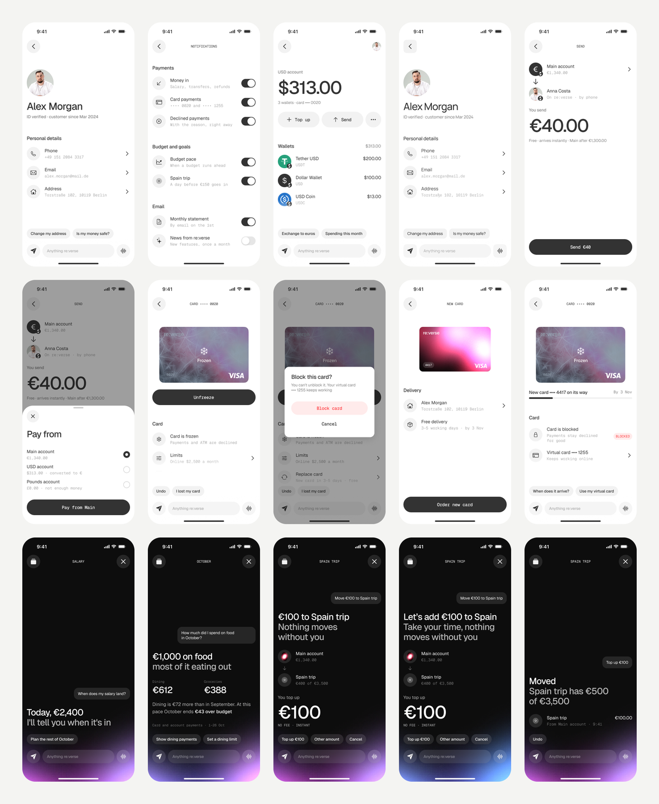

# re:verse DS — AI-ready дизайн-система

Дизайн-система мобильного банка, на которой Claude Code или Codex собирают экраны и целые флоу прямо в Figma по текстовому запросу. Агент описывает экран короткой спекой, а рендерер собирает его из компонентов и токенов системы с измеренными отступами. Линтер, аудит и независимый критик проверяют результат.

**Как всё устроено за 3 минуты:** [docs/how-it-works.md](docs/how-it-works.md)

## Быстрый старт
1. Нужны доступ к Figma-файлу «AI-ready DS» с **Full- или Dev-местом**, Node 18+, шрифты Geist и Geist Mono. Подробно: [docs/setup.md](docs/setup.md).
2. `git clone https://github.com/vladshukurov/aids.git reverse-ds` и откройте папку в Claude Code или Codex.
3. Подключите Figma MCP (`https://mcp.figma.com/mcp`) и попросите агента запустить `ds-doctor`.
4. Попросите: «Собери экран профиля» или «Флоу: заморозить потерянную карту и заказать новую».

Как формулировать запросы и ревьюить результат: [docs/working.md](docs/working.md).

## Что внутри
| Папка | Что там |
|---|---|
| `AGENTS.md` | Правила для любого агента: источники правды, пайплайн, жёсткие правила продукта. `CLAUDE.md` подключает его для Claude |
| `foundations/` | Сетка и все отступы (`layout.md`), планка качества, анти-паттерны, токены, темы, типографика, голос, данные персонажа |
| `components/` | Когда брать каждый компонент, блоки, иконки по смыслу; `_properties.md` генерируется из Figma |
| `recipes/` | Рецепты экранов: счёт, карта, профиль, настройки, транзакции, выбор, перевод, главная, ответ в чате |
| `specs/` | Формат спеки (`format.md`) и эталонные спеки экранов (`examples/`) |
| `scenarios/` | Флоу: md со сценарием и спека флоу (`freeze-card.json`) |
| `scripts/` | Линтер спек, сборщик вызова, рендерер, аудит экрана и флоу, синхронизация с Figma, проверка доков |
| `.agents/skills/` | Скиллы: build-screen, build-flow, audit-screen, sync-library, ds-doctor, report-friction, run-evals. Копия для Claude лежит в `.claude/skills/` |
| `agents/` | Критики: визуальный, UX-ревьюер флоу, доменный (банк, цифры), критик правил |
| `evals/` | Рубрики, тестовые запросы, эталоны для критика, журнал прогонов |
| `state/` | Карта Figma-файла (`figma.json`) и снимок библиотеки (`library.json`, генерируется) |
| `docs/` | Как устроено, установка, работа, поддержка, подводные камни Figma API, презентация |

## Эталонные экраны

Эталонные спеки лежат в `specs/examples/` и `scenarios/freeze-card.json`: профиль, настройки уведомлений, USD-счёт, подтверждение перевода с выбором счёта, флоу заморозки карты и три ответа ассистента (один факт, сравнение цифр, перевод денег с проверкой и сменой характера). Как они выглядят в Figma: секция `Polygon · evals` и [docs/examples.md](docs/examples.md).

## Видео процесса
Hero-ролик 16:9: [hero.mp4](docs/video/hero.mp4).

Серия клипов 4:3 по шагам пайплайна, без титров, каждый под свою карточку:
1. [01-ask.mp4](docs/video/01-ask.mp4) — запрос в чате, агент рассуждает (правила, рецепт, план, данные, спека, линтер, Figma, аудит) и отдаёт экран.
2. [02-spec-to-screen.mp4](docs/video/02-spec-to-screen.mp4) — спека собирает экран блок за блоком, строки спеки подсвечиваются.
3. [03-flow.mp4](docs/video/03-flow.mp4) — флоу заморозки карты как кликабельный прототип.
4. [04-switch.mp4](docs/video/04-switch.mp4) — один переключатель меняет характер ассистента и бренд (re:verse → Atlas).
5. [05-library.mp4](docs/video/05-library.mp4) — все эталонные экраны одной плоскостью.

Пересобрать: `python3 scripts/video/clips.py <папка с 2x-экспортами> <папка кадров>`, затем `swift scripts/video/encode.swift <папка кадров>/<клип> docs/video/<клип>.mp4`.

## Для тех, кто поддерживает систему
[docs/maintaining.md](docs/maintaining.md): что делать после изменения компонента или правила, где живёт каждый факт, проверки перед мерджем (`npm run lint`, `npm run check`). История изменений: [CHANGELOG.md](CHANGELOG.md).
